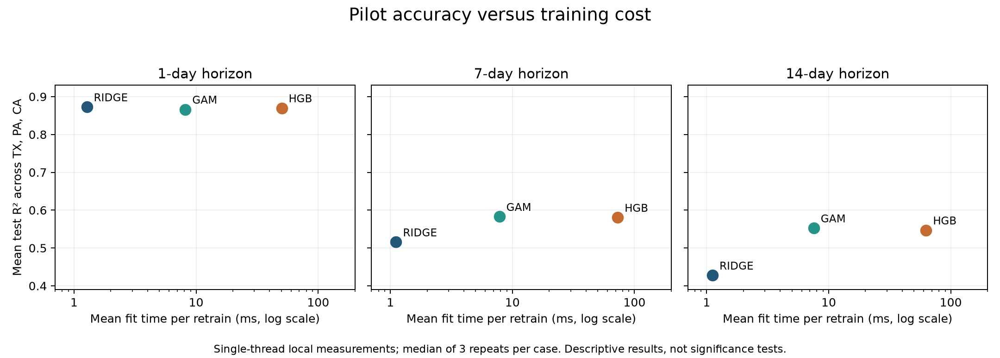

# Stage 1 computational practicality benchmark

## Scope and outcome

Completed the planned three-state pilot: TX, PA, CA × 1, 7, 14 days × Ridge, GAM, HGB. Every one of the 27 workloads ran three times (81 trials). Each model/case ran in its own sequential subprocess. Hyperparameters and predictions were verified against Stage 0 on every trial. No features were changed and Stage 2 has not begun.

## Cost results

Each entry below averages nine case medians (three timing repeats per case). Tuning covers the full original 12-choice search, including validation prediction/scoring. Fit time is per 14-day retraining event; each event uses the growing available history. Single prediction latency includes preprocessing and uses the final fitted model, measured with 100 one-row calls per repeat.

| Model | Tuning (s) | Fit per retrain (ms) | One prediction (µs) | Process peak RSS (MiB) |
|---|---:|---:|---:|---:|
| RIDGE | 0.016 | 1.17 | 121 | 259.4 |
| GAM | 0.081 | 7.84 | 744 | 322.3 |
| HGB | 0.657 | 62.01 | 399 | 257.0 |

Memory is the lifetime resident-memory high-water mark of the whole isolated Python process, including imports, loaded/prepared data, tuning and all three repeats. It is NOT model-only memory and cannot be assigned separately to tuning or fitting. Pre-fit high-water marks are recorded for context; subtracting two high-water marks would not provide a reliable incremental memory estimate. Memory readings are one per case/process, not three independent replicates.

## Accuracy

Equal-weight state mean R². These reproduce Stage 0 results to numerical tolerance, with no benchmark-specific retuning protocol.

| Horizon (days) | Ridge | GAM | HGB |
|---|---:|---:|---:|
| 1 | 0.8725 | 0.8663 | 0.8698 |
| 7 | 0.5155 | 0.5827 | 0.5805 |
| 14 | 0.4277 | 0.5525 | 0.5470 |



## Measurement protocol

- Corrected Stage 0 calendar alignment, information cutoffs, 27 features, evaluation dates and hyperparameter grids retained.
- Preprocessing arrays and date selection are outside timed sections. Fitting includes learned preprocessing (scaling and GAM splines); prediction includes those transformations.
- Twelve tuning settings per model, selected on the same development splits as Stage 0.
- Untimed small warmup, then three complete tuning/backtest repeats within each model/case subprocess.
- Fixed shuffled workload order, one worker at a time, native thread pools limited to one.
- Timing uses perf_counter wall time. This machine was not reserved exclusively; operating-system/background activity can affect measurements. Min/max repeat ranges are supplied.
- End-to-end compute totals exclude interpreter startup, imports, I/O and feature construction. Stored block-prediction cost is for up to 14 rows; single-origin latency is measured separately.
- No energy consumption, GPU cost, cloud price, national-scale runtime or user-decision improvement was measured.

## Interpretation

Ridge is the cheapest to fit and has the highest mean one-day R² in the pilot. GAM has slightly higher mean R² than HGB at seven and fourteen days and fits about eight times faster when averaged across the nine cases. However, GAM uses a higher whole-process memory peak and takes longer per single prediction than HGB. It is therefore not a universal winner across resource dimensions.

All three models fit in well under one second per retraining event on average and single predictions take under one millisecond on average. At this pilot scale, absolute computational cost alone gives little reason to reject any model. These data support measuring the practical trade-off, not claiming a deployment bottleneck or energy advantage.

## Interpretation limits

This is a small state-level tabular task. Ratios can look large even when all absolute costs are modest. Model selection should consider actual deployment constraints rather than assume that a slower model is impractical. Hardware and single-thread settings affect the ranking; these results should not be generalized to all implementations or deployment scales. Three repeats describe timing variability, not statistical uncertainty in model accuracy.

The original evaluation period has already been inspected. It must not become the iterative feature-selection set in Stage 2; choose features using development data and freeze the comparison before evaluating them.

## Reproduce

From the workspace root:

```sh
.venv/bin/python stage1/benchmark.py
.venv/bin/python stage1/summarize.py
```

Use the Stage 0 locked environment. Running again overwrites Stage 1 results. Raw per-case JSON includes native thread-pool details; CSVs include all repeats, per-case medians, ranges and model/horizon summaries. `environment.json` records machine details and benchmark/source hashes.

Hardware: Apple M1 Pro; 32 GiB physical memory; Python 3.14.0.
