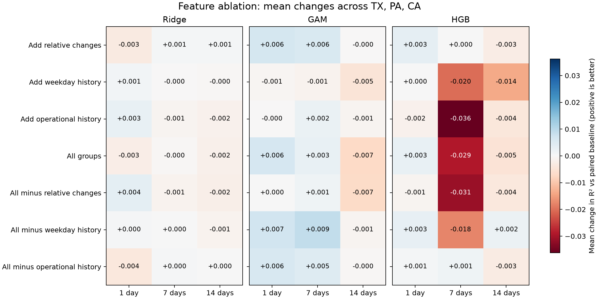

# Stage 3 pilot ablation results

## Main findings

- No broad improvement from adding all eight features: mean change in R² is -0.00154 for Ridge, +0.00045 for GAM and -0.01039 for HGB.
- Relative dynamics is the clearest small candidate for GAM: mean R² +0.00390; mean RMSE change -1.28%; six of nine cases improve. Average fit-cost ratio is 1.12. By horizon, mean R² changes are +0.00629 at one day, +0.00553 at seven days and -0.00011 at fourteen days. This is modest and horizon-dependent.
- GAM with relative dynamics plus operational history has the highest aggregate GAM R² among the tested variants (+0.00493 vs baseline), but improves only five of nine cases and costs about 1.22 times as much to fit. Its higher retrospective mean does not establish it as the best deployment choice.
- Weekday history does not provide consistent gains; it lowers average R² for GAM and HGB. Operational history alone lowers HGB R² in all nine cases.
- These results do not demonstrate that engineered features let Ridge close the nonlinear-model gap. They show that feature usefulness depends on model and horizon, and that extra inputs can hurt.
- If advancing a compact candidate for further validation, retain GAM plus relative dynamics as a hypothesis, not a proven winner. Avoid another feature-search loop against these same evaluation outcomes.


## Scope

Completed the eight frozen variants × three models × three states × three horizons (216 configurations). All comparisons use identical valid origin dates within a state/horizon. Each configuration was tuned prospectively with the original 12-setting budget, then evaluated with corrected 14-calendar-day retraining. No feature group was changed after observing these results.

Each full configuration was run once. Cost measurements are exploratory single-run timings, not the repeated timing benchmark used in Stage 1. Prediction latency uses 100 calls to the final fitted model. Memory is one whole-process high-water mark per model/variant across all nine state/horizon cases; it is not per-case or model-only memory. Full candidate feature construction is timed for every variant to establish the common population; it is NOT the incremental construction cost of a selected feature group.

## Mean changes relative to paired baseline

Each mean weights the nine state/horizon cases equally. Negative RMSE/MAE percentage change is better. Improved counts refer to R², without significance tests.

| Model | Variant | ΔR² | RMSE change | MAE change | Cases improved /9 | Fit cost ratio |
|---|---|---:|---:|---:|---:|---:|
| RIDGE | add_relative_dynamics | -0.0007 | +0.61% | +0.74% | 6 | 1.21× |
| RIDGE | add_weekday_history | +0.0001 | -0.12% | -0.19% | 4 | 1.04× |
| RIDGE | add_operational_history | +0.0000 | -0.26% | -0.12% | 5 | 1.06× |
| RIDGE | all | -0.0015 | +0.62% | +0.74% | 3 | 1.11× |
| RIDGE | without_relative_dynamics | +0.0001 | -0.39% | -0.31% | 5 | 1.01× |
| RIDGE | without_weekday_history | -0.0003 | +0.21% | +0.48% | 5 | 1.03× |
| RIDGE | without_operational_history | -0.0011 | +0.70% | +0.78% | 5 | 1.02× |
| GAM | add_relative_dynamics | +0.0039 | -1.28% | -1.30% | 6 | 1.12× |
| GAM | add_weekday_history | -0.0022 | +0.28% | +0.24% | 3 | 1.09× |
| GAM | add_operational_history | +0.0005 | -0.05% | -0.08% | 4 | 1.17× |
| GAM | all | +0.0004 | -0.85% | -0.96% | 5 | 1.27× |
| GAM | without_relative_dynamics | -0.0018 | +0.21% | +0.12% | 4 | 1.17× |
| GAM | without_weekday_history | +0.0049 | -1.45% | -1.54% | 5 | 1.22× |
| GAM | without_operational_history | +0.0033 | -1.17% | -1.28% | 6 | 1.21× |
| HGB | add_relative_dynamics | +0.0003 | -0.36% | -0.35% | 4 | 1.15× |
| HGB | add_weekday_history | -0.0113 | +1.21% | +1.07% | 4 | 1.17× |
| HGB | add_operational_history | -0.0140 | +1.67% | +1.34% | 0 | 0.93× |
| HGB | all | -0.0104 | +0.86% | +0.22% | 3 | 1.48× |
| HGB | without_relative_dynamics | -0.0119 | +1.38% | +0.78% | 4 | 1.31× |
| HGB | without_weekday_history | -0.0042 | +0.20% | -0.27% | 5 | 1.39× |
| HGB | without_operational_history | -0.0003 | -0.08% | -0.24% | 5 | 1.50× |



## Contribution checks

Positive add-one change means the group helps against baseline. Positive full-minus-without means removing it worsens performance. These effects include prospective retuning and do not isolate a causal effect of the features.

| Model | Group | Add-one ΔR² | Full minus without ΔR² |
|---|---|---:|---:|
| RIDGE | relative_dynamics | -0.0007 | -0.0016 |
| RIDGE | weekday_history | +0.0001 | -0.0013 |
| RIDGE | operational_history | +0.0000 | -0.0004 |
| GAM | relative_dynamics | +0.0039 | +0.0023 |
| GAM | weekday_history | -0.0022 | -0.0045 |
| GAM | operational_history | +0.0005 | -0.0029 |
| HGB | relative_dynamics | +0.0003 | +0.0015 |
| HGB | weekday_history | -0.0113 | -0.0061 |
| HGB | operational_history | -0.0140 | -0.0101 |

## Limits and next decision

This remains a three-state pilot on an already inspected retrospective evaluation period. Rankings are descriptive, not statistically established winners or nationwide claims. No intervals or multiple-comparison-adjusted significance tests were calculated. Test-set rankings must not trigger another round of feature invention on this same test period.

Feature effects may depend on model, horizon and state; inspect horizon_summary.csv and paired_changes.csv rather than relying solely on the aggregate. Current operational inputs still assume finalized end-of-day availability. The Delaware missingness issue from Stage 2 remains relevant to nationwide expansion.

The next planned stage is a decision-support prototype using these observed trade-offs. It should expose scope and uncertainty rather than present a universally optimal model. No prototype or user study was performed in this stage.

## Reproduce

```sh
.venv/bin/python stage3/ablation.py
.venv/bin/python stage3/summarize.py
```

Use the Stage 0 locked environment. These commands overwrite Stage 3 outputs. Saved artifacts include per-origin predictions, tuning scores/settings and cutoff audits for every configuration, all raw metrics, paired deltas, summaries, workload memory/thread metadata and verification results.
