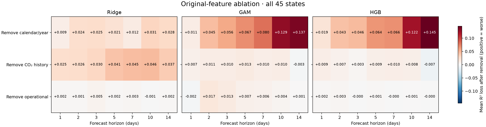
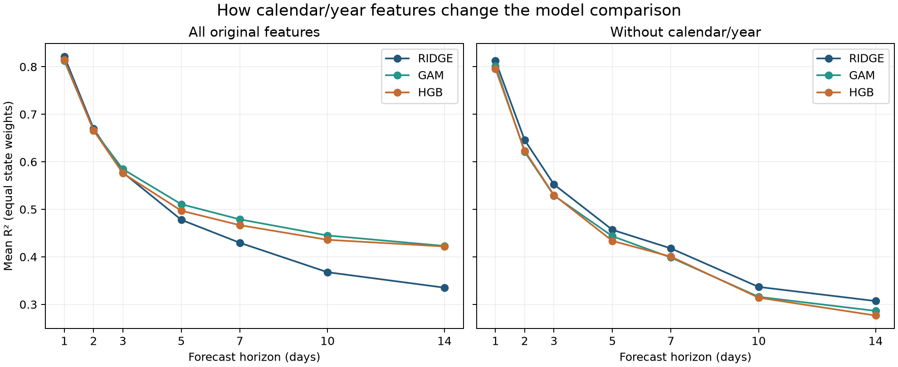

# Full-dataset original-feature ablation

Completed and validated **6,615 configurations**: 45 eligible states × 7 horizons (1,2,3,5,7,10,14 days) × 3 models × 7 variants. All results use the paper’s original 27 primary features; none of our Stage 2 additions is included.

## Main findings

The nonlinear models’ longer-horizon advantage depends strongly on the original calendar/year feature group under this corrected protocol. Without that group, Ridge has the highest national mean R² at every tested horizon. This is a conditional predictive comparison, not a causal finding or proof that complexity never helps.

**Fourteen-day forecasts, mean R² across 45 states:**

| Inputs | Ridge | GAM | HGB |
|---|---:|---:|---:|
| All original features | 0.3352 | 0.4230 | 0.4219 |
| Without calendar/year | 0.3071 | 0.2863 | 0.2765 |

Removing calendar/year at fourteen days worsens GAM in 43/45 states and HGB in 44/45 states. Median R² losses are 0.1375 and 0.1407, respectively, close to the corresponding mean losses. This pattern is therefore not driven solely by a few extreme state results.

With all original features, Ridge leads the national means at one and two days; GAM leads at three through fourteen days. HGB is slightly below Ridge at three days and first exceeds it at the tested five-day horizon. The earlier reported three-day HGB crossover must therefore not be repeated unchanged after these corrections. These rankings describe averages, without formal significance tests.

CO₂ history is the most consequential removed group for Ridge when averaged across all state/horizon cases. Calendar/year is the most consequential group for GAM and HGB. Operational inputs contribute comparatively little incremental predictive value when the other groups remain, although their correlated information can still be useful when history is absent.

The most defensible manuscript addition is a nationwide original-feature ablation explaining which predictor group supports the model-by-horizon pattern. The calendar/year group bundles year, annual cycles, weekday cycles and weekend status; further decomposition would be needed to attribute the result to any one component.

## National mean R²

States receive equal weight. These are descriptive scores under the corrected evaluation protocol.

| Days | Model | Full | Without calendar/year | Without CO₂ history | Without operational |
|---:|---|---:|---:|---:|---:|
| 1 | RIDGE | 0.8218 | 0.8125 | 0.7971 | 0.8202 |
| 1 | GAM | 0.8123 | 0.8016 | 0.8052 | 0.8147 |
| 1 | HGB | 0.8145 | 0.7959 | 0.8054 | 0.8126 |
| 2 | RIDGE | 0.6697 | 0.6456 | 0.6440 | 0.6684 |
| 2 | GAM | 0.6662 | 0.6208 | 0.6553 | 0.6494 |
| 2 | HGB | 0.6658 | 0.6232 | 0.6592 | 0.6626 |
| 3 | RIDGE | 0.5774 | 0.5525 | 0.5471 | 0.5724 |
| 3 | GAM | 0.5846 | 0.5290 | 0.5743 | 0.5714 |
| 3 | HGB | 0.5761 | 0.5299 | 0.5731 | 0.5763 |
| 5 | RIDGE | 0.4779 | 0.4568 | 0.4366 | 0.4761 |
| 5 | GAM | 0.5107 | 0.4434 | 0.4981 | 0.5034 |
| 5 | HGB | 0.4971 | 0.4335 | 0.4884 | 0.4957 |
| 7 | RIDGE | 0.4296 | 0.4178 | 0.3850 | 0.4268 |
| 7 | GAM | 0.4789 | 0.3986 | 0.4687 | 0.4730 |
| 7 | HGB | 0.4667 | 0.4005 | 0.4572 | 0.4668 |
| 10 | RIDGE | 0.3677 | 0.3367 | 0.3216 | 0.3686 |
| 10 | GAM | 0.4450 | 0.3159 | 0.4346 | 0.4407 |
| 10 | HGB | 0.4359 | 0.3141 | 0.4275 | 0.4348 |
| 14 | RIDGE | 0.3352 | 0.3071 | 0.2980 | 0.3335 |
| 14 | GAM | 0.4230 | 0.2863 | 0.4263 | 0.4222 |
| 14 | HGB | 0.4219 | 0.2765 | 0.4288 | 0.4221 |





## Original-group removal, averaged across 315 state/horizon cases

Positive loss means removal hurt. Counts describe direction, not statistical significance.

| Model | Removed group | Mean R² loss | Mean RMSE change | Cases worsened /315 |
|---|---|---:|---:|---:|
| RIDGE | calendar | +0.0215 | +2.59% | 295 |
| RIDGE | co2_history | +0.0357 | +4.17% | 301 |
| RIDGE | operational | +0.0019 | +0.22% | 188 |
| GAM | calendar | +0.0750 | +7.72% | 300 |
| GAM | co2_history | +0.0083 | +1.17% | 193 |
| GAM | operational | +0.0066 | +0.74% | 223 |
| HGB | calendar | +0.0720 | +7.54% | 301 |
| HGB | co2_history | +0.0055 | +0.99% | 191 |
| HGB | operational | +0.0010 | +0.13% | 177 |

## Group-only comparison

| Model | Full mean R² | Calendar only | CO₂ history only | Operational only |
|---|---:|---:|---:|---:|
| RIDGE | 0.5256 | 0.1427 | 0.5045 | 0.4494 |
| GAM | 0.5601 | 0.3676 | 0.4850 | 0.4390 |
| HGB | 0.5540 | 0.3992 | 0.4834 | 0.4427 |

## Protocol and validation

Supplied daily 2019–2025 aggregates; daily calendar reindexing; no imputation; targets constructed before row filtering; all variants use full-baseline complete-case dates. Training targets must be observed at each end-of-day forecast origin, including inner tuning cutoffs. Original 12-choice grids are retuned for each variant; models refit every 14 calendar days. Seven variants partition calendar/year (8), CO₂ history (13, including today), and operational inputs (6).

Every forecast file was checked for finite values, exact horizon, unique dates and identical targets/dates across variants. R², RMSE and MAE were recalculated from predictions. All saved fitting/tuning cutoffs were checked. All 189 pilot configurations reproduce their prior predictions to numerical tolerance. Source/data/prior-output hashes were verified.

The earlier run produced horizons 1,7,14 in stage3_nationwide/results; this extension produced 2,3,5,10 in stage3_full/results. Outputs were combined only after checking completeness and protocol identities. Both runners checkpoint each configuration.

## Limits

These are retrospective finalized-data comparisons, not a demonstration of real-time data access. Original facility exports and historical dependency lock were unavailable; supplied aggregation and eligibility were not independently reconstructed. Complete-case filtering changes coverage across states, especially those with missing records or load inputs; see full_coverage.csv. All feature variants within a state/horizon nevertheless use identical dates.

Removal measures conditional predictive value, not causality. Correlated groups can substitute for one another. Calendar/year encodings are bundled, so effects cannot be attributed to seasonality alone. Every variant is retuned; removal effects include model adaptation. National averages can hide state differences, so medians/ranges/direction counts are supplied in full_state_distribution.csv.

No confidence intervals, multiplicity-adjusted significance tests or causal claims are made. This completes the descriptive full-dataset ablation, not every statistical analysis in the manuscript. Corrected scores differ from the original manuscript protocol; their difference cannot be assigned solely to one repair.

Concurrent execution and an earlier machine/filesystem interruption contaminate runtime observations. Do not use these timings for computational-cost claims; Stage 1’s controlled pilot benchmark remains separate. No manuscript has been edited or published.

## Outputs and reproduction

Full metrics and paired changes: full_metrics.csv and full_paired_changes.csv. Summary, horizon, state-distribution, coverage and verification files are in results/. Per-origin predictions, audits and checkpoints are retained in their originating runner directories.

```sh
.venv/bin/python -B stage3_nationwide/run.py
.venv/bin/python -B stage3_full/run.py
.venv/bin/python -B stage3_full/summarize.py
```

The runners are locked and resumable. They refuse a resume if protected sources change. Use the Stage 0 locked environment.
