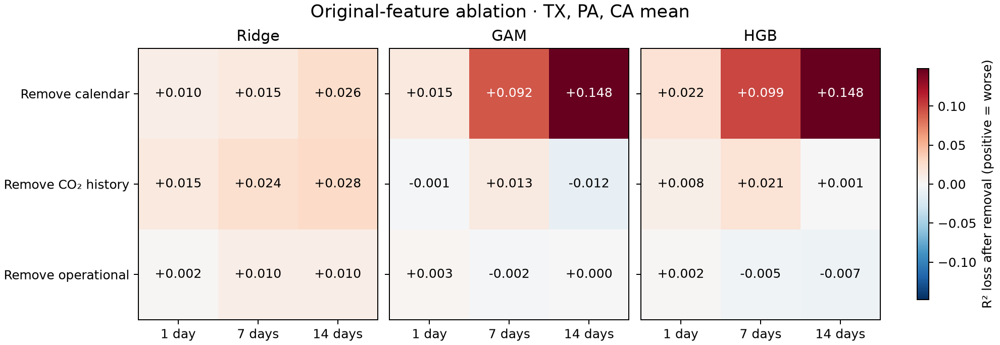

# Ablation of the paper’s original features

## Main findings

The original calendar/year group accounts for much of the nonlinear models' advantage in this pilot, conditional on the evaluation and tuning protocol. At fourteen days, full-model mean R² is 0.4277 (Ridge), 0.5525 (GAM) and 0.5470 (HGB). After removing calendar/year features it becomes 0.4022, 0.4047 and 0.3991 respectively. Thus GAM/HGB's sizeable descriptive advantage over Ridge nearly disappears. The group includes year plus seasonal/weekday encodings; this experiment does not separate those components or establish causality.

At seven days, removing calendar/year features also erases the nonlinear-model advantage: Ridge 0.5005, GAM 0.4905, HGB 0.4814, compared with full-model 0.5155, 0.5827 and 0.5805. This provides a more specific hypothesis about the source of the horizon-dependent performance gap than a general claim that complexity helps.

Removing operational inputs has a small average effect: R² changes by -0.0070 (Ridge), -0.0006 (GAM) and +0.0034 (HGB). These measurements do not establish that operational data are unimportant generally; emissions history may substitute for them.

Removing CO₂ history has model- and horizon-dependent effects. GAM's pooled change is approximately zero, despite changes of opposite sign at seven and fourteen days. Current operational measurements may proxy emissions, so this must not be interpreted as proof that emissions history contains no useful signal.

These are corrected three-state pilot findings, not yet national results. No formal statistical significance is claimed. A focused statement about the conditional role of calendar/year predictors is supported descriptively; the paper's national mechanism claim still requires a national rerun and appropriate uncertainty analysis.


## Scope correction

This experiment removes or isolates the paper’s ORIGINAL feature groups. It uses none of the eight features developed in Stage 2. The earlier Stage 3 experiment measured our proposed additions and is a separate study; its results must not be described as ablation of the paper’s original predictors.

## Design

Three groups partition the original 27 predictors: calendar (8, including year), CO₂ history (13, including current emissions), and operational inputs (6). Seven variants: full model; full minus each group; each group alone. The paper’s two excluded diagnostic emissions-ratio features are not part of this primary feature set.

All 189 configurations were run: seven variants × three models × three states × three horizons. Every variant uses identical full-baseline complete-case dates, and receives prospective tuning using the original 12-choice grid. Stage 0 temporal corrections are retained. All 27 full-model cases reproduce the corrected Stage 0 predictions.

## Removing original groups

Equal-weight means across nine state/horizon cases. Positive R² loss and positive RMSE change mean removing the group worsens performance.

| Model | Removed group | Mean R² loss | Mean RMSE change | Cases worsened /9 |
|---|---|---:|---:|---:|
| RIDGE | calendar | +0.0168 | +2.79% | 7 |
| RIDGE | co2_history | +0.0223 | +3.96% | 9 |
| RIDGE | operational | +0.0070 | +0.61% | 7 |
| GAM | calendar | +0.0849 | +10.52% | 9 |
| GAM | co2_history | -0.0001 | -0.42% | 5 |
| GAM | operational | +0.0006 | +0.20% | 4 |
| HGB | calendar | +0.0896 | +11.78% | 9 |
| HGB | co2_history | +0.0100 | +2.36% | 7 |
| HGB | operational | -0.0034 | -0.27% | 4 |



## Group-only models

The full baseline is repeated for reference. These models use the same dates as full models, not every date available to their smaller feature sets.

| Model | Full R² | Calendar only R² | CO₂ history only R² | Operational only R² |
|---|---:|---:|---:|---:|
| RIDGE | 0.6052 | 0.2336 | 0.5866 | 0.5526 |
| GAM | 0.6672 | 0.5173 | 0.5902 | 0.5486 |
| HGB | 0.6657 | 0.5205 | 0.5769 | 0.5375 |

## Interpretation boundaries

Removal measures predictive contribution conditional on the remaining groups, not causal importance. Correlated operational/history predictors can substitute for each other. Removing CO₂ history removes today’s emissions as well as older lags. The models are retuned for every variant, so differences include adaptation to the remaining inputs.

These are three-state retrospective pilot results, with three horizons and no uncertainty intervals or multiplicity-adjusted significance tests. Do not infer a national ranking or use tiny descriptive differences as proof. Group-only or reduced models can outperform the full set in individual cases; report them rather than assume more features always help.

## Cost and reproducibility

One complete run per configuration; fit/tuning timing is exploratory, unlike the repeated Stage 1 benchmark. Peak RSS is whole-process memory across nine cases per model/variant. Original data and previous stages remain unchanged. Full metrics, per-origin predictions, tuning choices, cutoff audits and machine/source hashes are saved under results/.

```sh
.venv/bin/python stage3_original/ablation.py
.venv/bin/python stage3_original/summarize.py
```

Use the locked Stage 0 environment. Rerunning overwrites this experiment’s outputs. No prototype work is included.
