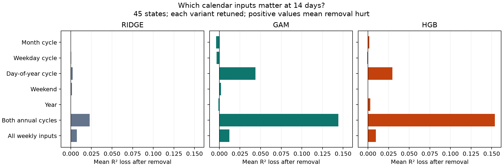

# Calendar component ablation: fourteen-day forecasts

Completed 945 configurations: 45 states × 3 models × 7 removals. Original features only; each variant retuned under the existing corrected protocol. Positive R² loss means removal hurt. States receive equal weight.

| Model | Removed | Mean R² | Mean R² loss | Median loss | States worsened /45 |
|---|---|---:|---:|---:|---:|
| gam | annual | 0.2786 | +0.1444 | +0.1409 | 43 |
| gam | day_of_year | 0.3792 | +0.0438 | +0.0391 | 42 |
| gam | month | 0.4269 | -0.0039 | -0.0008 | 21 |
| gam | weekday | 0.4263 | -0.0033 | +0.0006 | 34 |
| gam | weekend | 0.4211 | +0.0019 | +0.0004 | 34 |
| gam | weekly | 0.4109 | +0.0121 | +0.0096 | 42 |
| gam | year | 0.4241 | -0.0012 | +0.0014 | 26 |
| hgb | annual | 0.2681 | +0.1537 | +0.1499 | 44 |
| hgb | day_of_year | 0.3923 | +0.0295 | +0.0302 | 38 |
| hgb | month | 0.4202 | +0.0017 | -0.0001 | 20 |
| hgb | weekday | 0.4227 | -0.0008 | +0.0000 | 22 |
| hgb | weekend | 0.4219 | -0.0000 | +0.0000 | 0 |
| hgb | weekly | 0.4123 | +0.0095 | +0.0061 | 36 |
| hgb | year | 0.4192 | +0.0027 | +0.0029 | 27 |
| ridge | annual | 0.3122 | +0.0230 | +0.0220 | 36 |
| ridge | day_of_year | 0.3330 | +0.0022 | +0.0005 | 29 |
| ridge | month | 0.3351 | +0.0001 | -0.0007 | 15 |
| ridge | weekday | 0.3346 | +0.0006 | +0.0004 | 31 |
| ridge | weekend | 0.3336 | +0.0016 | +0.0013 | 41 |
| ridge | weekly | 0.3279 | +0.0073 | +0.0067 | 43 |
| ridge | year | 0.3353 | -0.0002 | -0.0016 | 20 |

Annual removes both month and day-of-year sine/cosine pairs; weekly removes weekday sine/cosine and weekend. Year is removed separately. All other original inputs remain.

Interpretation is restricted to the tested fourteen-day horizon. Overlapping predictors can replace one another; removal effects are conditional, are not additive importance shares, and include retuning. No causal or statistical-significance claims are made. Calendar features describe the forecast origin date.

Validation: every saved prediction was checked against baseline dates and targets; horizons, finite values, recomputed metrics and fitting/tuning cutoffs were checked. Source and data hashes are saved by the runner.

## Interpretation

The annual-cycle encodings account for the largest conditional predictive effect at fourteen days. Removing both annual pairs leaves Ridge at 0.3122, ahead of GAM (0.2786) and HGB (0.2681), although numeric year and weekly encodings remain. GAM and HGB worsen in 43 and 44 states respectively. Numeric year removal has little average effect, while weekly removal produces smaller losses.

Month and day-of-year overlap: a negligible month-only removal effect does not establish that month is useless when day-of-year is absent. The joint annual removal is much more damaging than either individual removal. These effects cannot be added as importance shares.

This is an exploratory follow-up at a horizon selected from prior results. It supports annual calendar patterns as the dominant component of the earlier group-level finding at this horizon. It does not establish a physical cause, significance, or attribution at other horizons.

